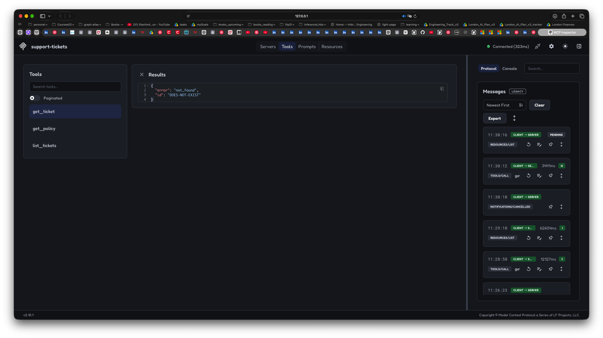

# R1 — Ticket functions as MCP tools (Day 1)

**FastMCP** is the server-building interface we use from the MCP Python SDK
(`mcp.server.fastmcp`). It exposes Python functions as tools through the Model
Context Protocol (MCP). The `@mcp.tool()` decorator registers a function, while
its type hints and docstring describe the tool's inputs, output, and purpose.
FastMCP handles MCP requests and responses; our functions still do the actual
work. It does not choose which tool to call—the client, or an AI model through
the client, makes that choice.

### What our FastMCP server actually does

Our server is a running Python process that lets an MCP client use our ticket
functions. In this project, it communicates over **stdio**: the client sends
protocol messages through the process's standard input and reads responses from
its standard output. We do not need to expose an HTTP endpoint for this setup.

1. **Advertises tools.** When the client asks for the tool list, the server returns
   the names, descriptions, and input schemas of our three registered tools.
2. **Receives a tool call.** For example, Inspector requests `get_ticket` with
   `{"ticket_id": "T-1001"}`. This is a structured request, not natural language.
3. **Validates and dispatches.** FastMCP checks the arguments against the tool's
   declared input types and calls the registered wrapper in `server.py`.
4. **Runs our existing logic.** The wrapper calls `functions.get_ticket("T-1001")`,
   which reads the JSON fixture and returns the matching ticket or a `not_found`
   dictionary.
5. **Returns an MCP response.** FastMCP packages the Python result into a protocol
   response and sends it back to the client.

```text
Inspector or an agent application's MCP client
    → get_ticket request with ticket_id="T-1001"
    → FastMCP tool wrapper in server.py
    → lookup logic in functions.py
    → result packaged as an MCP response
    → client receives the ticket or not_found result
```

The server does not interpret a user's question or decide whether a refund should
be issued. It exposes the operations we registered and executes the requested
one. With Inspector, we choose the call manually; with an agent, the model can
choose it and the agent application sends it through the MCP client.

From this folder, activate the shared root environment with `source ../.venv/bin/activate`. Run tests with `python -m pytest --cov=src --cov-report=term-missing --cov-fail-under=80`. See the root README for dependency installation.


We will now be exposing python functions as mcp tools via an mcp server.
The larger task is (imaginary scenario) building an ops agent for a financial company and initially will be focusing on the "refunds agent."

- [ ] write the functions as per their specs below
- [ ] test the functions with pytest 
- [ ] expose the functions with FastMCP as tools
- [ ] Use MCP Inspector to test the server


### What functions we will build...
**list_tickets** — the agent’s way to find tickets without knowing an id. Takes optional filters (status, customer, maybe a tag) and returns a compact list: id, subject, status, customer, created date — enough to pick one, not the whole record, because the model will read every returned token. An empty match returns an empty list, not an error.

**get_ticket** — one ticket in full by id: the summary fields plus the refund-relevant ones (amount disputed, refund status, which policy it references). An unknown id comes back as a clean “not found” error the model can act on, never a raised exception that kills the run. Customer card and NI fields are either absent from the data this tool reads or stripped here, so no later stage can leak them.

**get_policy** — one policy document by id, returned as text with its id and title, so the agent can quote it when it answers “which policy applies”. Unknown id → the same clean error shape as get_ticket.

Ok, once done - test the functions with tests/test_functions.py

### Three levels of testing

| Test level | Question it answers | How we will test |
| --- | --- | --- |
| Python function test | Does the ticket lookup logic work? | Use `pytest` to call the Python functions directly and assert their results. |
| MCP client test | Can a client discover and call the tool correctly? | Use Inspector for manual checks, then `pytest` with an MCP client session for automated discovery and tool-call checks. |
| LLM agent test | Does the model choose the right tool and use its result correctly? | Use the OpenAI Agents SDK to connect an agent to our MCP server, give it natural-language tasks, and check its tool choices, arguments, and final answers. |

Inspector addresses the MCP client level manually: you choose the tool, supply
arguments, and inspect the result. Automated MCP client tests repeat those checks
in code. Neither requires an LLM.

====

### Test the server with MCP Inspector

MCP Inspector is a client for manually testing your MCP server. You select a tool
and supply its arguments; no AI model is involved. Inspector sends the request
through MCP, your server calls the Python function, and Inspector displays the result.

From the `r1-functions-to-mcp-tools` folder, launch Inspector with:

```bash
npx @modelcontextprotocol/inspector ../.venv/bin/python src/server.py
```

Keep that terminal running while testing. In the browser interface, connect to the
server if necessary and select **Tools**.


The screenshot shows tool discovery: all three tools are listed, the selected
tool's docstring appears as its description, and its parameter becomes an input
field. It does not yet show a completed tool call.

#### Run the manual tests

Select a tool on the left, enter the inputs below, then click **Execute Tool**.
Compare the returned data with the expected result; a connected indicator alone
does not prove a tool works.

| Test | Tool | Inputs | Expected result |
| --- | --- | --- | --- |
| Existing ticket | `get_ticket` | `ticket_id`: `T-1001` | Ticket with ID `T-1001` and subject `Card declined twice` |
| Unknown ticket | `get_ticket` | `ticket_id`: `DOES-NOT-EXIST` | `{"error": "not_found", "id": "DOES-NOT-EXIST"}` |
| All tickets | `list_tickets` | Omit both filters | Eight ticket summaries |
| Open tickets | `list_tickets` | `status`: `open`; omit `customer_id` | Four tickets: `T-1001`, `T-1003`, `T-1006`, `T-1008` |
| Both filters | `list_tickets` | `status`: `open`; `customer_id`: `C-42` | Three tickets: `T-1001`, `T-1003`, `T-1008` |
| No matching tickets | `list_tickets` | `customer_id`: `DOES-NOT-EXIST`; omit `status` | An empty list |
| Existing policy | `get_policy` | `policy_id`: `POL-REFUND-01` | Policy titled `Refund window`, with its ID and text |
| Unknown policy | `get_policy` | `policy_id`: `DOES-NOT-EXIST` | `{"error": "not_found", "id": "DOES-NOT-EXIST"}` |

These expected results refer to the current JSON fixtures in `data/`.
For optional filters, omit the argument rather than sending an empty string.
If the form makes this unclear, enable **Edit as JSON** and use `{}` for all
tickets, or `{"status": "open"}` for open tickets.

The missing-ID result is an expected application response. The current functions
return an error dictionary normally, so Inspector may show a successful MCP call
alongside `"error": "not_found"`. Check the returned data, not just the success label.

If the tool list is blank or a request times out, the test has not passed. Try
disconnecting and reconnecting, and inspect the **Protocol** and **Console** panels
plus the launching terminal for errors.

After running the existing-ticket and unknown-ticket tests, save a screenshot of
each result under `docs/evidence/screenshots/`. These demonstrate tool execution;
the screenshot above demonstrates discovery. Stop Inspector with **Ctrl-C** in
the launching terminal when finished.

#### Captured test results

Existing ticket: `get_ticket` with `ticket_id="T-1001"` returns the ticket details.


Unknown ticket: `get_ticket` with `ticket_id="DOES-NOT-EXIST"` returns the expected
`not_found` dictionary.


